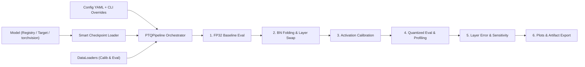
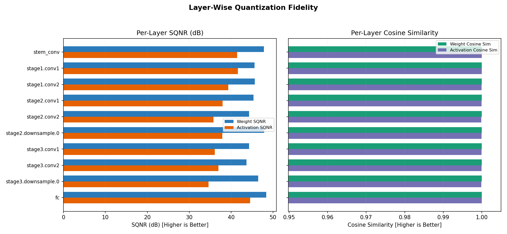
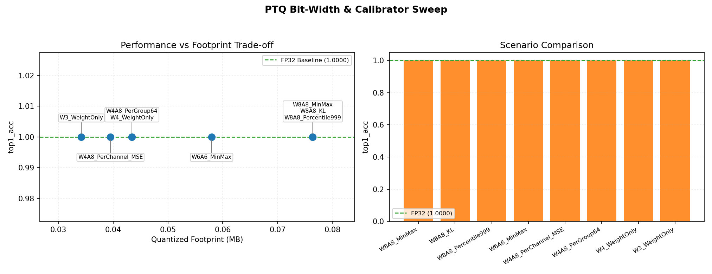

# Post-Training Quantization (PTQ) Simulation


A modular PyTorch Post-Training Quantization (PTQ) simulation framework built for controlled experiments across CNNs, MLPs, and Transformers. Swap a `state_dict` checkpoint, model definition, dataset, bit-width, or calibration observer through YAML configs, CLI overrides, or Python calls without modifying the core quantization engine.

---

## Capabilities

| Component | Supported Options |
|---|---|
| Quantization Modes | Static W/A, Dynamic W/A (per-tensor or per-token), Weight-Only (skips activation calibration) |
| Bit-Widths | Arbitrary uniform integer widths from `2` to `16` bits (`W8A8`, `W6A6`, `W4A8`, `W4A16`, `W3`, `W2`) |
| Schemes | Symmetric and asymmetric, signed and unsigned, optional narrow range, zero-point inclusion control |
| Granularity | `per_tensor`, `per_channel`, and `per_group` (arbitrary group size with edge-replication padding) |
| Calibration Observers | `minmax`, `ema` (moving average), `percentile` (streaming histogram / exact quantiles), `mse`, `kl` (entropy) |
| Graph & Layer Prep | `torch.fx` BatchNorm folding (`Conv2d+BN2d`, `Linear+BN1d`) with `nn.Sequential` fallback, regex `skip_layers`, per-layer `layer_overrides` |
| Diagnostics & Profiling | Layer-wise weight and activation error (`MSE`, `RMSE`, `MAE`, `Max Abs`, `SQNR dB`, `Cosine Sim`), single-layer sensitivity ranking, footprint (MB), compression ratio, qparam overhead, BitOps |
| Exports & Plots | `summary_report.md`, `metrics_summary.json`, CSV diagnostics, `qparams.json`, `quantized_simulated.pt`, `quantized_int_package.pt`, distribution & Pareto PNG plots |

---

## Architecture



### Repository Layout

```text
post-hoc_quantization_simulation/
├── configs/                        # YAML presets for static, per-group, weight-only, and sweep runs
├── checkpoints/                    # Directory for user model weights (.pt / .pth)
├── docs/assets/                    # Sample plots displayed in documentation
├── outputs/                        # Timestamped run artifacts (ignored by git)
├── scripts/
│   ├── train_demo_model.py         # Quick synthetic training script to generate demo weights
│   ├── inspect_checkpoint.py       # Inspect keys, shapes, dtypes, and FP32 size of .pt/.pth files
│   ├── run_ptq.py                  # Main CLI for single PTQ simulation runs
│   └── run_sweep.py                # Multi-scenario bit-width and calibrator sweep CLI
├── src/ptq_sim/
│   ├── config/                     # Typed dataclass schemas, validation, and dotted overrides
│   ├── quantization/               # Uniform math, 5 observers, FakeQuantizer, Quant* modules, BN folding, preparer, calibrator
│   ├── models/                     # Model registry, torchvision adapter, dynamic loader, smart loader, example models
│   ├── data/                       # Dataset registry, learnable synthetic datasets, vision adapters
│   ├── evaluation/                 # Task evaluator, layer-wise analyzer, sensitivity ranking, size & BitOps profiler
│   ├── visualization/              # Matplotlib plots for distributions, SQNR/cosine, sensitivity, Pareto curves
│   ├── export/                     # Report, CSV, qparams JSON, simulated & integer package exporters
│   ├── pipeline/                   # PTQPipeline and SweepRunner orchestrators
│   ├── utils/                      # Deterministic seeding, device resolution, logging, safe I/O
│   └── cli.py                      # Console script entrypoints (ptq-run, ptq-sweep)
└── tests/                          # Unit and end-to-end integration tests (unittest)
```

---

## Installation

Requires Python `3.10+` and PyTorch `2.0+`.

```bash
git clone https://github.com/arunikadev/post-hoc_quantization_simulation.git
cd post-hoc_quantization_simulation

# Standard editable install (installs dependencies declared in pyproject.toml)
pip install -e .

# Or in an environment where PyTorch is already installed:
pip install -e . --no-build-isolation --no-deps
```

Editable installation exposes both `python scripts/...` and console entrypoints `ptq-run` and `ptq-sweep`.

---

## Quickstart

### 1. Train a demo checkpoint

Generates a trained `MiniResNet` `state_dict` on the deterministic `synthetic_image` dataset in a few seconds:

```bash
python scripts/train_demo_model.py \
  --model mini_resnet \
  --epochs 5 \
  --save-path checkpoints/demo_mini_resnet.pth
```

### 2. Inspect any `.pt` / `.pth` checkpoint

```bash
python scripts/inspect_checkpoint.py --checkpoint checkpoints/demo_mini_resnet.pth
```

### 3. Run PTQ simulations

```bash
# W8A8 static MinMax with single-layer sensitivity analysis
python scripts/run_ptq.py \
  --config configs/base.yaml \
  --model mini_resnet \
  --checkpoint checkpoints/demo_mini_resnet.pth \
  --sensitivity

# W4 per-group (group_size=64) weights + A8 percentile on MiniTransformer
python scripts/run_ptq.py \
  --config configs/w4a8_per_group.yaml \
  --model mini_transformer \
  --dataset synthetic_sequence

# W4 weight-only (skips activation calibration automatically)
python scripts/run_ptq.py \
  --config configs/w4a16_weight_only.yaml \
  --model mini_resnet \
  --checkpoint checkpoints/demo_mini_resnet.pth \
  --dataset synthetic_image
```

### 4. Run a multi-configuration sweep

```bash
python scripts/run_sweep.py \
  --config configs/sweep_bitwidths.yaml \
  --model mini_resnet \
  --checkpoint checkpoints/demo_mini_resnet.pth
```

*(On Windows PowerShell, use backticks `` ` `` instead of `\` for multi-line commands.)*

---

## Plugging In Your Own Model and `state_dict`

### Option 1: Swap checkpoint only

Pass `--checkpoint` to `run_ptq.py`. The checkpoint loader in [`src/ptq_sim/models/loader.py`](src/ptq_sim/models/loader.py) automatically handles:
- Raw `state_dict` dictionaries
- Wrapped dictionaries (`model_state_dict`, `state_dict`, `model`, `net`, `weights`, `ema_state_dict`), or a custom `--state-dict-key`
- Full pickled `nn.Module` objects
- Prefix stripping for `module.` (`DataParallel` / `DistributedDataParallel`) and `_orig_mod.` (`torch.compile`)

### Option 2: Dynamic Python import or `torchvision`

Load any external PyTorch `nn.Module` class without editing framework files:

```bash
# Load a class directly from a Python file or module path
python scripts/run_ptq.py \
  --config configs/base.yaml \
  --target "path/to/my_model.py:MyModelClass" \
  --checkpoint checkpoints/my_weights.pth \
  --w-bits 4 --a-bits 8 --w-granularity per_group --group-size 64 --calibrator kl

# Or use any torchvision architecture
python scripts/run_ptq.py \
  --config configs/w8a8_static_kl.yaml \
  --model torchvision:resnet18 \
  --checkpoint checkpoints/resnet18.pth
```

For models or datasets requiring constructor arguments (`kwargs`), copy the patterns in [`src/ptq_sim/models/custom_template.py`](src/ptq_sim/models/custom_template.py) and [`src/ptq_sim/data/custom_template.py`](src/ptq_sim/data/custom_template.py) and point `model.target` / `data.target` in your YAML config.

### Option 3: Python API

Pass live `nn.Module` and `DataLoader` instances directly into `PTQPipeline`:

```python
from ptq_sim import PTQExperimentConfig, PTQPipeline

cfg = PTQExperimentConfig.from_yaml("configs/base.yaml").apply_overrides({
    "experiment_name": "custom_w4a8",
    "quantization.weight.bit_width": 4,
    "quantization.weight.granularity": "per_group",
    "quantization.weight.group_size": 64,
    "quantization.activation.observer": "percentile",
    "evaluation.run_sensitivity": True,
})

result = PTQPipeline(cfg).run(
    model=my_pytorch_model,          # Optional if model is configured in YAML
    calib_loader=my_calib_loader,    # Optional for weight-only or dynamic activation modes
    eval_loader=my_val_loader,
    eval_fn=None,                    # Optional custom fn(model, loader, device) -> dict[str, float]
)

print(result.fp32_metrics, result.quant_metrics, result.profile)
```

---

## Configuration Presets & Mixed Precision

| Config File | Purpose |
|---|---|
| [`configs/base.yaml`](configs/base.yaml) | W8A8 static PTQ (`per_channel` MinMax weights, `per_tensor` asymmetric MinMax activations, BN folding enabled) |
| [`configs/w8a8_static_kl.yaml`](configs/w8a8_static_kl.yaml) | W8A8 static PTQ using 2048-bin KL-divergence (entropy) activation calibration |
| [`configs/w4a8_per_group.yaml`](configs/w4a8_per_group.yaml) | W4 `per_group` (`group_size=64`) weights + A8 percentile (99.9) activations on `MiniTransformerClassifier` |
| [`configs/w4a16_weight_only.yaml`](configs/w4a16_weight_only.yaml) | W4 `per_group` weight-only simulation (no activation quantizers, no calibration loader required) |
| [`configs/sweep_bitwidths.yaml`](configs/sweep_bitwidths.yaml) | 8-scenario comparison spanning W8A8, W6A6, W4A8, W4 weight-only, and W3 weight-only |

Any field in `PTQExperimentConfig` can be overridden via `--override key.path=value`, and individual layers can be skipped or assigned different bit-widths in YAML:

```yaml
quantization:
  skip_layers:
    - "fc"                   # Exact layer name or regex pattern
  layer_overrides:
    "stem_conv":
      weight:
        bit_width: 8
    "stage3\\..*":
      weight:
        bit_width: 6
        granularity: per_group
        group_size: 32
```

---

## Outputs & Sample Results

Each simulation writes a timestamped folder under `outputs/<experiment_name>_<timestamp>/`:
- `config_resolved.yaml`: full configuration after CLI overrides
- `metrics_summary.json` & `summary_report.md`: FP32 vs. quantized metrics, footprint, compression ratio, BitOps, and worst/most-sensitive layers
- `layer_analysis.csv` & `sensitivity_analysis.csv`: per-layer weight/activation error and single-layer degradation rankings
- `qparams.json`: calibrated scale, zero-point, bit-width, and granularity metadata per layer
- `quantized_simulated.pt`: reloadable fake-quantized `state_dict`
- `quantized_int_package.pt`: clamped integer weight tensors (`int8`/`uint8`/`int16`) paired with scales, zero-points, and biases
- `plots/`: `weight_distributions.png`, `activation_distributions.png`, `layer_error_metrics.png`, and `sensitivity_ranking.png`

### Measured Sweep Example (`MiniResNet` on `synthetic_image`, CUDA)

Baseline FP32 model: `0.2964 MB` (`77,706` params), `1.0000` top-1 accuracy, `9` folded `Conv2d+BatchNorm2d` pairs, `10` quantized layers.

| Scenario | W / A Bits | Weight Granularity | Act Observer | FP32 Acc | Quant Acc | Footprint (MB) | Compression | Mean Act SQNR (dB) |
|---|---|---|---|---:|---:|---:|---:|---:|
| `W8A8_MinMax` | W8 / A8 | `per_channel` | `minmax` | 1.0000 | 1.0000 | 0.0764 | 3.88x | 38.62 |
| `W8A8_KL` | W8 / A8 | `per_channel` | `kl` | 1.0000 | 1.0000 | 0.0764 | 3.88x | 20.03 |
| `W8A8_Percentile999` | W8 / A8 | `per_channel` | `percentile` | 1.0000 | 1.0000 | 0.0764 | 3.88x | 28.40 |
| `W6A6_MinMax` | W6 / A6 | `per_channel` | `minmax` | 1.0000 | 1.0000 | 0.0580 | 5.11x | 26.32 |
| `W4A8_PerChannel_MSE` | W4 / A8 | `per_channel` | `percentile` | 1.0000 | 1.0000 | 0.0395 | 7.50x | 17.40 |
| `W4A8_PerGroup64` | W4 / A8 | `per_group` | `minmax` | 1.0000 | 1.0000 | 0.0434 | 6.82x | 17.41 |
| `W4_WeightOnly` | W4 / FP32 | `per_group` | `minmax` | 1.0000 | 1.0000 | 0.0434 | 6.82x | 17.44 |
| `W3_WeightOnly` | W3 / FP32 | `per_group` | `minmax` | 1.0000 | 1.0000 | 0.0342 | 8.66x | 10.67 |

### Sample Visualizations






---

## Testing

Run the full unit and integration test suite using Python's built-in `unittest` runner (`21` tests across `6` test files):

```bash
python -m unittest discover -s tests -v
```

Test coverage includes uniform quantization bounds and edge-replication padding (`test_functional_quant.py`), all 5 observers including outlier robustness (`test_observers.py`), `torch.fx` and fallback BatchNorm folding numerical equivalence (`test_bn_folding.py`), layer overrides and dynamic/weight-only modes (`test_modules_and_preparer.py`), checkpoint unwrapping and export reloadability (`test_loader_and_export.py`), and end-to-end pipeline and sweep runs (`test_pipeline_e2e.py`).

---

## License

Released under the MIT License.
