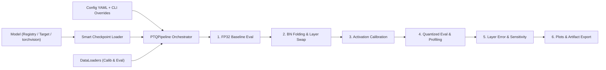
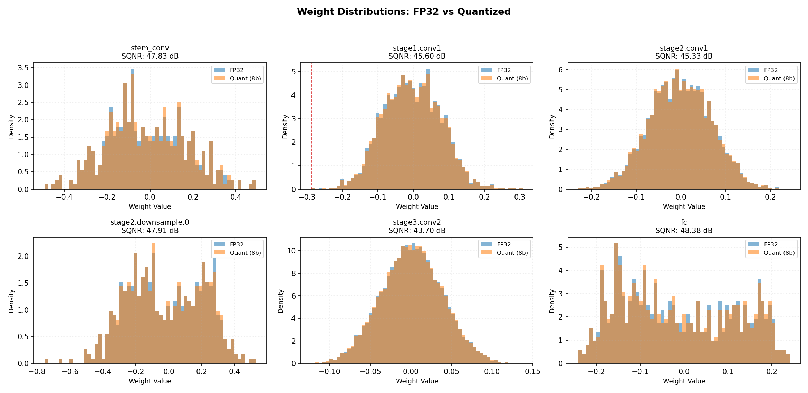

# Post-Training Quantization (PTQ) Simulation


A modular PyTorch Post-Training Quantization (PTQ) simulation framework built for controlled experiments across CNNs, MLPs, and Transformers. Swap a `state_dict` checkpoint, model definition, dataset, bit-width, or calibration observer through YAML configs, CLI overrides, or Python calls without modifying the core quantization engine.

---

## Capabilities

| Component | Supported Options |
|---|---|
| Quantization Modes | Static W/A, Dynamic W/A (per-tensor or per-token), Weight-Only (skips activation calibration) |
| Bit-Widths | Arbitrary uniform integer widths from `2` to `16` bits (`W8A8`, `W6A6`, `W4A8`, `W4A16`, `W3`, `W2`) |
| Schemes | Symmetric and asymmetric, signed and unsigned, optional narrow range, zero-point inclusion control |
| Granularity | `per_tensor`, `per_channel`, and `per_group` (arbitrary group size with edge-replication padding) |
| Calibration Observers | `minmax`, `ema` (moving average), `percentile` (streaming histogram / exact quantiles), `mse`, `kl` (entropy) |
| Graph & Layer Prep | `torch.fx` BatchNorm folding (`Conv2d+BN2d`, `Linear+BN1d`) with `nn.Sequential` fallback, regex `skip_layers`, per-layer `layer_overrides` |
| Diagnostics & Profiling | Layer-wise weight and activation error (`MSE`, `RMSE`, `MAE`, `Max Abs`, `SQNR dB`, `Cosine Sim`), single-layer sensitivity ranking, footprint (MB), compression ratio, qparam overhead, BitOps |
| Exports & Plots | `summary_report.md`, `metrics_summary.json`, CSV diagnostics, `qparams.json`, `quantized_simulated.pt`, `quantized_int_package.pt`, distribution & Pareto PNG plots |

---

## Architecture



### Repository Layout

```text
post-hoc_quantization_simulation/
├── configs/                        # YAML presets for static, per-group, weight-only, and sweep runs
├── checkpoints/                    # Directory for user model weights (.pt / .pth)
├── docs/assets/                    # Sample plots displayed in documentation
├── outputs/                        # Timestamped run artifacts (ignored by git)
├── scripts/
│   ├── train_demo_model.py         # Quick synthetic training script to generate demo weights
│   ├── inspect_checkpoint.py       # Inspect keys, shapes, dtypes, and FP32 size of .pt/.pth files
│   ├── run_ptq.py                  # Main CLI for single PTQ simulation runs
│   └── run_sweep.py                # Multi-scenario bit-width and calibrator sweep CLI
├── src/ptq_sim/
│   ├── config/                     # Typed dataclass schemas, validation, and dotted overrides
│   ├── quantization/               # Uniform math, 5 observers, FakeQuantizer, Quant* modules, BN folding, preparer, calibrator
│   ├── models/                     # Model registry, torchvision adapter, dynamic loader, smart loader, example models
│   ├── data/                       # Dataset registry, learnable synthetic datasets, vision adapters
│   ├── evaluation/                 # Task evaluator, layer-wise analyzer, sensitivity ranking, size & BitOps profiler
│   ├── visualization/              # Matplotlib plots for distributions, SQNR/cosine, sensitivity, Pareto curves
│   ├── export/                     # Report, CSV, qparams JSON, simulated & integer package exporters
│   ├── pipeline/                   # PTQPipeline and SweepRunner orchestrators
│   ├── utils/                      # Deterministic seeding, device resolution, logging, safe I/O
│   └── cli.py                      # Console script entrypoints (ptq-run, ptq-sweep)
└── tests/                          # Unit and end-to-end integration tests (unittest)
```

---

## Installation

Requires Python `3.10+` and PyTorch `2.0+`.

```bash
git clone https://github.com/arunikadev/post-hoc_quantization_simulation.git
cd post-hoc_quantization_simulation

# Standard editable install (installs dependencies declared in pyproject.toml)
pip install -e .

# Or in an environment where PyTorch is already installed:
pip install -e . --no-build-isolation --no-deps
```

Editable installation exposes both `python scripts/...` and console entrypoints `ptq-run` and `ptq-sweep`.

---

## Quickstart

### 1. Train a demo checkpoint

Generates a trained `MiniResNet` `state_dict` on the deterministic `synthetic_image` dataset:

```bash
python scripts/train_demo_model.py \
  --model mini_resnet \
  --epochs 5 \
  --save-path checkpoints/demo_mini_resnet.pth
```

### 2. Inspect any `.pt` / `.pth` checkpoint

```bash
python scripts/inspect_checkpoint.py --checkpoint checkpoints/demo_mini_resnet.pth
```

### 3. Run PTQ simulations

```bash
# W8A8 static MinMax with single-layer sensitivity analysis
python scripts/run_ptq.py \
  --config configs/base.yaml \
  --model mini_resnet \
  --checkpoint checkpoints/demo_mini_resnet.pth \
  --sensitivity

# W4 per-group (group_size=64) weights + A8 percentile on MiniTransformer
python scripts/run_ptq.py \
  --config configs/w4a8_per_group.yaml \
  --model mini_transformer \
  --dataset synthetic_sequence

# W4 weight-only (skips activation calibration automatically)
python scripts/run_ptq.py \
  --config configs/w4a16_weight_only.yaml \
  --model mini_resnet \
  --checkpoint checkpoints/demo_mini_resnet.pth \
  --dataset synthetic_image
```

### 4. Run a multi-configuration sweep

```bash
python scripts/run_sweep.py \
  --config configs/sweep_bitwidths.yaml \
  --model mini_resnet \
  --checkpoint checkpoints/demo_mini_resnet.pth
```

*(On Windows PowerShell, replace `\` line continuations with backticks `` ` ``.)*

---

## Experimentation Guide: What to Edit (YAML vs. CLI)

For normal experimentation, do **not** edit the core modules in [`src/ptq_sim/quantization/`](src/ptq_sim/quantization), [`src/ptq_sim/evaluation/`](src/ptq_sim/evaluation), [`src/ptq_sim/export/`](src/ptq_sim/export), or [`src/ptq_sim/pipeline/`](src/ptq_sim/pipeline). Copy [`configs/base.yaml`](configs/base.yaml) (for example to `configs/my_exp.yaml`) and edit only the sections below, or override parameters directly on the CLI.

### 1. Swap `state_dict` / Checkpoint Only

Place your `.pt` or `.pth` file inside `checkpoints/`. The smart loader in [`src/ptq_sim/models/loader.py`](src/ptq_sim/models/loader.py) accepts raw `state_dict` files, wrapped dicts (`model_state_dict`, `state_dict`, `model`, `net`, `weights`, `ema_state_dict`), pickled `nn.Module` objects, and automatically strips `module.` (`DataParallel` / `DDP`) and `_orig_mod.` (`torch.compile`) prefixes.

**YAML (`model:` block in [`configs/base.yaml`](configs/base.yaml)):**
```yaml
model:
  name: mini_resnet
  checkpoint: checkpoints/my_weights.pth
  state_dict_key: null   # Set if nested under an uncommon key, e.g. "ema_model"
  strict_load: true      # Set false to allow partial key matching
```

**CLI:**
```bash
python scripts/run_ptq.py --config configs/base.yaml \
  --model mini_resnet \
  --checkpoint checkpoints/my_weights.pth

# Optional when checkpoint uses a custom wrapper key:
python scripts/run_ptq.py --config configs/base.yaml \
  --model mini_resnet \
  --checkpoint checkpoints/my_weights.pth \
  --state-dict-key my_custom_key
```

### 2. Swap Model Architecture

Built-in models: `simple_cnn`, `mini_resnet`, `simple_mlp`, `mini_transformer`, or any `torchvision` model using `torchvision:<arch>`. For custom architectures, follow the template in [`src/ptq_sim/models/custom_template.py`](src/ptq_sim/models/custom_template.py) without registering inside the package.

**YAML (`model:` block in [`configs/base.yaml`](configs/base.yaml)):**
```yaml
model:
  name: custom                       # Ignored when target is set
  target: "my_models/net.py:MyNet"   # Or dotted path "my_models.net:MyNet"
  kwargs:                            # Constructor arguments passed to MyNet(...)
    in_channels: 3
    num_classes: 100
  checkpoint: checkpoints/my_net.pth
```
*(For `torchvision`, set `name: "torchvision:resnet18"`, `target: null`, and `kwargs: { num_classes: 1000 }`.)*

**CLI:**
```bash
# Custom Python model file + constructor kwargs override
python scripts/run_ptq.py --config configs/base.yaml \
  --target "my_models/net.py:MyNet" \
  --checkpoint checkpoints/my_net.pth \
  --override model.kwargs.num_classes=100

# torchvision model directly
python scripts/run_ptq.py --config configs/w8a8_static_kl.yaml \
  --model torchvision:resnet18 \
  --checkpoint checkpoints/resnet18.pth
```

### 3. Swap Calibration & Evaluation Datasets

Built-in datasets: `synthetic_image`, `synthetic_tabular`, `synthetic_sequence`, `cifar10`, `mnist`, and `image_folder` (defined in [`src/ptq_sim/data/vision.py`](src/ptq_sim/data/vision.py)). For custom data pipelines, follow [`src/ptq_sim/data/custom_template.py`](src/ptq_sim/data/custom_template.py) to return `(calib_loader, eval_loader)`.

**YAML (`data:` block in [`configs/base.yaml`](configs/base.yaml)):**
```yaml
data:
  name: image_folder                 # Or cifar10 / mnist / synthetic_image
  target: null                       # Or "my_data/loaders.py:build_my_loaders"
  kwargs:
    calib_dir: "data/calib"
    eval_dir: "data/val"
    image_size: 224
  calib_batch_size: 32
  eval_batch_size: 64
  num_calib_batches: 16              # Number of calibration batches to observe
```

**CLI:**
```bash
python scripts/run_ptq.py --config configs/base.yaml \
  --dataset cifar10 \
  --override data.kwargs.download=true \
  --override data.num_calib_batches=16

# Custom DataLoader factory
python scripts/run_ptq.py --config configs/base.yaml \
  --override data.target="my_data/loaders.py:build_my_loaders"
```

### 4. Tune Bit-Width, Granularity, Calibrator, & PTQ Modes

Preset baselines live in [`configs/`](configs):

| Config Preset | Configuration Summary |
|---|---|
| [`configs/base.yaml`](configs/base.yaml) | W8A8 static PTQ (`per_channel` MinMax weights, `per_tensor` asymmetric MinMax activations, BN folding enabled) |
| [`configs/w8a8_static_kl.yaml`](configs/w8a8_static_kl.yaml) | W8A8 static PTQ using 2048-bin KL-divergence (entropy) activation calibration |
| [`configs/w4a8_per_group.yaml`](configs/w4a8_per_group.yaml) | W4 `per_group` (`group_size=64`) weights + A8 percentile (`99.9`) activations on `MiniTransformerClassifier` |
| [`configs/w4a16_weight_only.yaml`](configs/w4a16_weight_only.yaml) | W4 `per_group` weight-only simulation (no activation quantizers, no calibration loader required) |
| [`configs/sweep_bitwidths.yaml`](configs/sweep_bitwidths.yaml) | 8-scenario sweep spanning W8A8, W6A6, W4A8, W4 weight-only, and W3 weight-only |

**YAML (`quantization:` block in [`configs/base.yaml`](configs/base.yaml)):**
```yaml
quantization:
  fold_bn: true                      # Fold Conv2d+BN2d and Linear+BN1d before swapping
  quantize_types: [Conv2d, Linear]
  quantize_input: true               # Set false together with activation.enabled=false for weight-only
  quantize_output: false
  weight:
    enabled: true
    bit_width: 4                     # Integer 2..16
    symmetric: true
    signed: true
    narrow_range: true
    granularity: per_group           # per_tensor | per_channel | per_group
    group_size: 64
    observer: mse                    # minmax | ema | percentile | mse | kl
    observer_kwargs: {}
  activation:
    enabled: true                    # Set false for Weight-Only PTQ
    dynamic: false                   # Set true for Dynamic PTQ (no calibration data needed)
    bit_width: 8
    symmetric: false
    signed: false
    granularity: per_tensor          # per_tensor | per_channel | per_group
    observer: percentile
    observer_kwargs:
      percentile: 99.9
```

**CLI:**
```bash
# W4 per-group (g=64) + MSE weight observer + A8 KL activation observer
python scripts/run_ptq.py --config configs/base.yaml \
  --model mini_resnet --checkpoint checkpoints/demo_mini_resnet.pth \
  --w-bits 4 --a-bits 8 --w-granularity per_group --group-size 64 \
  --w-observer mse --calibrator kl

# Weight-Only W4 (skips activation quantization and calibration)
python scripts/run_ptq.py --config configs/base.yaml \
  --model mini_resnet --checkpoint checkpoints/demo_mini_resnet.pth \
  --w-bits 4 --w-granularity per_group --group-size 64 --weight-only

# Dynamic Activation W8A8 (per-channel / per-token along last dim for Transformers)
python scripts/run_ptq.py --config configs/base.yaml \
  --model mini_transformer --dataset synthetic_sequence \
  --w-bits 8 --a-bits 8 --dynamic-act --a-granularity per_channel

# Override nested observer kwargs or disable BN folding
python scripts/run_ptq.py --config configs/base.yaml \
  --calibrator percentile \
  --override quantization.activation.observer_kwargs.percentile=99.9 \
  --override quantization.weight.symmetric=false \
  --no-fold-bn
```

### 5. Skip Layers & Per-Layer Mixed Precision

After running sensitivity analysis, keep sensitive layers (such as the stem or final classification head) in FP32 or higher bit-widths while compressing the rest of the network.

**YAML (`quantization.skip_layers` and `quantization.layer_overrides` in [`configs/base.yaml`](configs/base.yaml)):**
```yaml
quantization:
  skip_layers:
    - "fc"                   # Exact layer name or regex pattern (e.g. ".*head.*")
  layer_overrides:
    "stem_conv":
      weight:
        bit_width: 8
    "stage3\\..*":           # Regex matching all layers inside stage3
      weight:
        bit_width: 6
        granularity: per_group
        group_size: 32
```

**CLI:**
```bash
python scripts/run_ptq.py --config configs/base.yaml \
  --model mini_resnet --checkpoint checkpoints/demo_mini_resnet.pth \
  --w-bits 4 --skip-layers stem_conv fc
```
*(Use YAML `layer_overrides` for fine-grained mixed-precision configs across many layers.)*

### 6. Configure Evaluation, Sensitivity Analysis, Plots & Exports

**YAML (`evaluation:` block in [`configs/base.yaml`](configs/base.yaml)):**
```yaml
evaluation:
  task: classification       # classification | regression | language_modeling
  max_eval_batches: null     # Cap batches when iterating large validation datasets
  run_layer_analysis: true   # Per-layer MSE, RMSE, MAE, Max Abs, SQNR (dB), Cosine Sim
  layer_analysis_batches: 4
  run_sensitivity: false     # One-at-a-time single-layer sensitivity ranking
  sensitivity_max_batches: 8
  generate_plots: true       # Save PNG charts to outputs/<run>/plots/
  export_artifacts: true     # Save report, JSON, CSVs, qparams.json, and .pt packages
```

**CLI:**
```bash
# Enable sensitivity ranking
python scripts/run_ptq.py --config configs/base.yaml --sensitivity

# Fast terminal-only run without saving plots or artifacts
python scripts/run_ptq.py --config configs/base.yaml --no-plots --no-export

# Skip layer analysis or switch task type
python scripts/run_ptq.py --config configs/base.yaml --no-layer-analysis
python scripts/run_ptq.py --config configs/base.yaml --override evaluation.task=regression
```

### 7. Configure Multi-Scenario Sweeps

Edit or copy [`configs/sweep_bitwidths.yaml`](configs/sweep_bitwidths.yaml) to compare multiple bit-widths, granularities, or observers against the same model and checkpoint in one command.

**YAML ([`configs/sweep_bitwidths.yaml`](configs/sweep_bitwidths.yaml)):**
```yaml
base_config: configs/base.yaml
sweep_name: my_custom_sweep
output_dir: outputs

scenarios:
  - name: W8A8_KL
    overrides:
      quantization.weight.bit_width: 8
      quantization.activation.observer: kl
  - name: W4A8_Group32
    overrides:
      quantization.weight.bit_width: 4
      quantization.weight.granularity: per_group
      quantization.weight.group_size: 32
```

**CLI:**
```bash
python scripts/run_sweep.py \
  --config configs/sweep_bitwidths.yaml \
  --model mini_resnet \
  --checkpoint checkpoints/demo_mini_resnet.pth
```

### 8. Direct Python API & Custom Extensions

For custom domain metrics (F1, mAP, BLEU) or notebooks, pass live PyTorch objects and an optional `eval_fn(model, loader, device) -> dict[str, float]` directly to `PTQPipeline`:

```python
from ptq_sim import PTQExperimentConfig, PTQPipeline

cfg = PTQExperimentConfig.from_yaml("configs/base.yaml").apply_overrides({
    "experiment_name": "custom_w4a8",
    "quantization.weight.bit_width": 4,
    "quantization.weight.granularity": "per_group",
    "quantization.weight.group_size": 64,
    "quantization.activation.observer": "percentile",
    "evaluation.run_sensitivity": True,
})

result = PTQPipeline(cfg).run(
    model=my_pytorch_model,          # Optional if model is configured in YAML
    calib_loader=my_calib_loader,    # Optional for weight-only or dynamic activation modes
    eval_loader=my_val_loader,
    eval_fn=None,                    # Optional custom evaluation callable
)

print(result.fp32_metrics, result.quant_metrics, result.profile)
```

To add a new calibration observer algorithm, subclass `BaseObserver` and decorate it with `@register_observer("my_observer")` in [`src/ptq_sim/quantization/observers.py`](src/ptq_sim/quantization/observers.py).

### Quick Reference: What to Change

| Goal | YAML File / Section | CLI Equivalent |
|---|---|---|
| Swap weights (`state_dict`) | `model.checkpoint` in `configs/*.yaml` | `--checkpoint path/to/file.pth` |
| Swap model architecture | `model.name` or `model.target` + `kwargs` | `--model <name>` or `--target "file.py:Cls"` |
| Swap calibration / eval dataset | `data.name` or `data.target` + `kwargs` | `--dataset <name>` or `--override data.target=...` |
| Change W/A bit-widths or granularity | `quantization.weight.*` / `quantization.activation.*` | `--w-bits`, `--a-bits`, `--w-granularity`, `--group-size` |
| Switch PTQ mode or observer | `activation.enabled`, `activation.dynamic`, `observer` | `--weight-only`, `--dynamic-act`, `--calibrator`, `--w-observer` |
| Skip layers or set mixed precision | `quantization.skip_layers`, `quantization.layer_overrides` | `--skip-layers layer1 layer2` |
| Enable sensitivity / control outputs | `evaluation.*` in `configs/*.yaml` | `--sensitivity`, `--no-plots`, `--no-export` |
| Compare multiple settings together | `scenarios:` in [`configs/sweep_bitwidths.yaml`](configs/sweep_bitwidths.yaml) | `python scripts/run_sweep.py --config ...` |

---

## Outputs & Sample Results

Each simulation writes a timestamped folder under `outputs/<experiment_name>_<timestamp>/`:
- `config_resolved.yaml`: full configuration after CLI overrides
- `metrics_summary.json` & `summary_report.md`: FP32 vs. quantized metrics, footprint, compression ratio, BitOps, and worst/most-sensitive layers
- `layer_analysis.csv` & `sensitivity_analysis.csv`: per-layer weight/activation error and single-layer degradation rankings
- `qparams.json`: calibrated scale, zero-point, bit-width, and granularity metadata per layer
- `quantized_simulated.pt`: reloadable fake-quantized `state_dict`
- `quantized_int_package.pt`: clamped integer weight tensors (`int8`/`uint8`/`int16`) paired with scales, zero-points, and biases
- `plots/`: `weight_distributions.png`, `activation_distributions.png`, `layer_error_metrics.png`, and `sensitivity_ranking.png`

### Measured Sweep Example (`MiniResNet` on `synthetic_image`, CUDA)

Baseline FP32 model: `0.2964 MB` (`77,706` params), `1.0000` top-1 accuracy, `9` folded `Conv2d+BatchNorm2d` pairs, `10` quantized layers.

| Scenario | W / A Bits | Weight Granularity | Act Observer | FP32 Acc | Quant Acc | Footprint (MB) | Compression | Mean Act SQNR (dB) |
|---|---|---|---|---:|---:|---:|---:|---:|
| `W8A8_MinMax` | W8 / A8 | `per_channel` | `minmax` | 1.0000 | 1.0000 | 0.0764 | 3.88x | 38.62 |
| `W8A8_KL` | W8 / A8 | `per_channel` | `kl` | 1.0000 | 1.0000 | 0.0764 | 3.88x | 20.03 |
| `W8A8_Percentile999` | W8 / A8 | `per_channel` | `percentile` | 1.0000 | 1.0000 | 0.0764 | 3.88x | 28.40 |
| `W6A6_MinMax` | W6 / A6 | `per_channel` | `minmax` | 1.0000 | 1.0000 | 0.0580 | 5.11x | 26.32 |
| `W4A8_PerChannel_MSE` | W4 / A8 | `per_channel` | `percentile` | 1.0000 | 1.0000 | 0.0395 | 7.50x | 17.40 |
| `W4A8_PerGroup64` | W4 / A8 | `per_group` | `minmax` | 1.0000 | 1.0000 | 0.0434 | 6.82x | 17.41 |
| `W4_WeightOnly` | W4 / FP32 | `per_group` | `minmax` | 1.0000 | 1.0000 | 0.0434 | 6.82x | 17.44 |
| `W3_WeightOnly` | W3 / FP32 | `per_group` | `minmax` | 1.0000 | 1.0000 | 0.0342 | 8.66x | 10.67 |

### Sample Visualizations




---

## Testing

Run the full unit and integration test suite using Python's built-in `unittest` runner (`21` tests across `6` test files):

```bash
python -m unittest discover -s tests -v
```

Test coverage includes uniform quantization bounds and edge-replication padding (`test_functional_quant.py`), all 5 observers including outlier robustness (`test_observers.py`), `torch.fx` and fallback BatchNorm folding numerical equivalence (`test_bn_folding.py`), layer overrides and dynamic/weight-only modes (`test_modules_and_preparer.py`), checkpoint unwrapping and export reloadability (`test_loader_and_export.py`), and end-to-end pipeline and sweep runs (`test_pipeline_e2e.py`).

---

## License

Released under the MIT License.
